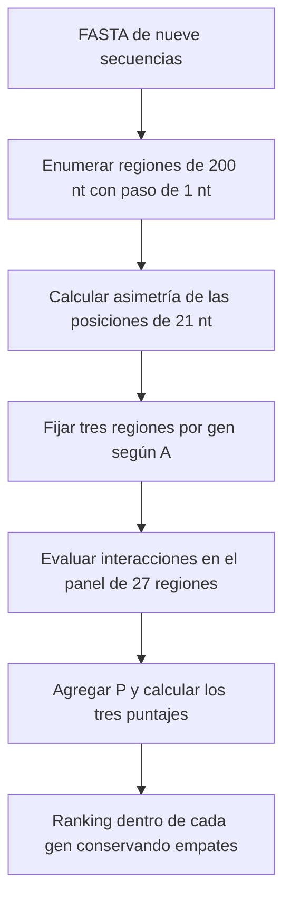

# Algoritmo propio: asimetría e interacciones no deseadas

El algoritmo ordena regiones de **200 nt dentro de cada secuencia candidata**
combinando dos descriptores: la proporción de posiciones de 21 nt con asimetría
termodinámica favorable y la proporción con alguna interacción no deseada que
cumple la política de evaluación. Utiliza las mismas
[nueve secuencias de referencia](../seleccion_genes/secuencias/genes_9.fasta)
que el benchmark.

## Método

Cada región de 200 nt contiene **180 posiciones solapadas de 21 nt**. Se calcula:

```text
A = posiciones con asimetría favorable / 180
P = posiciones con al menos una interacción no deseada calificante / 180
Sλ = A − λP                  λ = 0,5; 1; 2
```

La asimetría se calcula con el modelo y la tabla energética de dsRIP. Las
interacciones se evalúan con RNAhybrid, excluyendo los blancos previstos según
el gen y las coordenadas. A y P son descriptores computacionales; no son
probabilidades de eficacia o daño biológico.



La evaluación de interacciones se restringe a un **panel fijado antes de
examinar P**, con tres regiones por gen seleccionadas por A. Entre empates de A
se usa el orden de coordenadas para limitar el trabajo, sin atribuir superioridad
biológica a las regiones admitidas. Las regiones excluidas y los empates de
admisión están registrados en el manifiesto.

## Resultado principal

La asimetría se calculó para **10.993 regiones posibles**. La evaluación conjunta
de A y P abarca **27 regiones**, correspondientes a **1.821 posiciones distintas
de 21 nt**; el solapamiento entre regiones permite reutilizar posiciones.

**En las 27 regiones se obtuvo P = 180/180 = 1.** Por lo tanto, para cada valor
de λ se resta la misma constante y el ranking conserva el orden de A y sus
empates. La penalización no discrimina entre las regiones de este panel.

Las interacciones se buscaron en referencias de *D. maidis*, *Homo sapiens*,
*Zea mays*, *Apis mellifera* y MRFV. Se evaluaron 3.170 pares únicos
consulta–referencia. Una interacción positiva basta para marcar una posición;
las búsquedas restantes pueden detenerse. **P completo no significa que todas
las especies hayan sido evaluadas exhaustivamente**, ni que exista un riesgo
biológico del 100 %.

Los [resultados por gen](resultados/README.md) presentan todas las regiones
empatadas en el primer puesto y las coberturas por especie. La
[metodología](METODOLOGIA.md) especifica orientaciones, umbrales, exclusiones y
alcance de las búsquedas.

## Código y reproducción

- [Implementación](implementacion/README.md): módulos de asimetría, evaluación,
  cobertura, puntuación y ranking.
- [Tablas y metadatos](resultados/README.md): resultados del panel y sus
  identificadores de entrada.
- [Reproducibilidad](REPRODUCIBILIDAD.md): recálculo portable y requisitos de
  una evaluación nativa completa.

Desde la raíz del repositorio, con Python 3.11 o posterior y sin instalar
paquetes adicionales:

```bash
python algoritmo/reproducir.py
```

El comando recalcula A desde el FASTA, comprueba la admisión y reconstruye P,
puntajes y rankings a partir de las decisiones de interacción registradas.
Coinciden los **81 registros de ranking**, incluidos sus empates. La revisión
de los alineamientos originales de RNAhybrid requiere evidencia externa que
no está incluida en el repositorio.

## Relación con el benchmark

El [benchmark de tres herramientas](../benchmark/README.md) estudia concordancia
sobre 2.752 ventanas con paso de 4 nt. El algoritmo propio utiliza paso de 1 nt
para A y evalúa P sobre un panel seleccionado, con otras referencias y otra
política de interacción. Los resultados son complementarios; sus conteos y
puntajes no constituyen una comparación homogénea entre cuatro métodos.
No se ha demostrado superioridad predictiva ni eficacia experimental.
