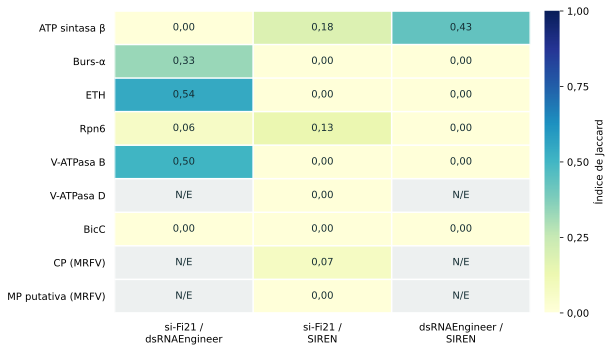

# Comparación de herramientas para la selección de regiones de RNAi

## Objetivo y conjunto de análisis

El benchmark compara si-Fi21, SIREN y dsRNAEngineer como herramientas para
interferencia por ARN (RNAi), sobre secuencias de la chicharrita del maíz,
*Dalbulus maidis*, y del virus del rayado fino del maíz (MRFV).

El conjunto incluye siete secuencias de *D. maidis* y dos de MRFV. Se analizan
**2.752 ventanas de 200 nt, con un desplazamiento de 4 nt**. Las coordenadas se
expresan desde 1, incluyendo ambos extremos, sobre
[genes_9.fasta](../seleccion_genes/secuencias/genes_9.fasta).

La comparación busca caracterizar la concordancia entre análisis y la influencia
de sus criterios. No dispone de un conjunto de validación experimental que
permita establecer cuál herramienta predice mejor la eficacia biológica.

El [informe de resultados](informe/benchmark_rnai.html) desarrolla la metodología
y la discusión. Las [tablas de datos](resultados/README.md) permiten examinar
cada región y sus indicadores.

## Herramientas y criterios

| Análisis | Información utilizada | Priorización de regiones |
| --- | --- | --- |
| si-Fi21 | Posiciones de siRNA con filtros de actividad predicha y coincidencias de secuencia. | Orden definido para este benchmark: menos coincidencias fuera de especie; después más coincidencias intraespecie; después más posiciones que pasan los filtros. |
| SIREN | Hibridaciones calculadas con RNAhybrid y score de interacciones no deseadas. | Mayor score, excluyendo el transcripto identificado como blanco. El score no incluye un término de eficacia. |
| dsRNAEngineer | Alineamientos de Bowtie agrupados por ventana. | Orden definido para este benchmark: menos coincidencias fuera de especie; después mayor cobertura conjunta on-target e intraespecie. |

si-Fi21 y SIREN utilizan cDNA de Ensembl para *D. maidis*; dsRNAEngineer utiliza
un ensamblado Trinity. También se consideran referencias de *Zea mays* y
*Apis mellifera* como especies no objetivo. Los conteos difieren en su unidad
y no deben compararse como cantidades equivalentes de genes afectados.

El modo `control_plaga` prioriza una mayor cobertura intraespecie tras minimizar
las coincidencias externas. Es un supuesto del análisis: una coincidencia
intraespecie puede corresponder a una isoforma del blanco o a otro gen, y no
demuestra un efecto biológico favorable. Las definiciones completas se presentan
en [Metodología](METODOLOGIA.md).

## Regiones priorizadas

Las columnas de si-Fi21 y dsRNAEngineer corresponden a rankings construidos
con sus datos para este benchmark. Las regiones se expresan en nucleótidos.

| Secuencia | si-Fi21 | SIREN | dsRNAEngineer |
| --- | --- | --- | --- |
| ATP sintasa β | 2449–2648 | 1005–1204 | 873–1072 |
| Burs-α | 65–264 | 249–448 | 33–232 |
| ETH | 217–416 | 37–236 | 217–416 |
| Rpn6 | 2209–2408 | 109–308 | 2145–2344 |
| V-ATPasa B | 1137–1336 | 241–440 | 1473–1672 |
| V-ATPasa D | 125–324 | 289–488 | Empate total |
| BicC | 2321–2520 | 1–200 | 1817–2016 |
| CP (MRFV) | 121–320 | 141–340 | Sin datos |
| MP putativa (MRFV) | 85–284 | 645–844 | Sin datos |

**Sin datos** indica ausencia de información útil para ordenar regiones en esa
evaluación. **Empate total** indica que el criterio no distingue entre las
ventanas. Ninguno de esos estados representa una recomendación de la primera
región de la secuencia.

## Interpretación

- **ETH:** si-Fi21 y dsRNAEngineer priorizan 217–416. El Jaccard del 10 % superior
  entre esos rankings es 0,54. La coincidencia es computacional y no demuestra
  eficacia experimental de esa región de 200 nt.
- **ATP sintasa β:** los rankings priorizan regiones diferentes. La región
  2449–2648 se ubica en la UTR 3′ del modelo de referencia; su contexto debe
  considerarse al interpretarla.
- **Rpn6:** se observan coincidencias con referencias no objetivo. Su evaluación
  requiere revisar regiones y unidades de conteo antes de atribuir significado
  biológico a esos valores.
- **MRFV:** la evaluación de dsRNAEngineer no aporta información que permita
  ordenar las regiones de las dos entradas virales.

La comparación muestra que la priorización depende del método y del criterio
utilizado. La coincidencia entre rankings, las predicciones de actividad y las
coincidencias de secuencia describen aspectos diferentes del problema. Una
región debe interpretarse junto con la evidencia biológica del gen y el alcance
de las referencias evaluadas.

*Jaccard en escala de 0 a 1. N/E: comparación no evaluable por ausencia de datos
o empate total; no equivale a cero.*

## Relación con el algoritmo propio

El proyecto también incluye un [algoritmo de asimetría e interacciones no
deseadas](../algoritmo/README.md). Ese análisis calcula A con paso de 1 nt y
evalúa interacciones en un panel de 27 regiones seleccionado por A. Considera
cinco referencias y conserva los empates del puntaje combinado.

Este benchmark compara tres herramientas sobre 2.752 ventanas con paso de 4 nt,
con sus respectivas métricas y referencias. La diferencia de población,
bases y reglas impide interpretar ambos resultados como un benchmark
homogéneo de cuatro métodos. Una comparación directa requeriría un protocolo
común de regiones, referencias, unidades y criterios.

## Acceso a los materiales

- [Metodología](METODOLOGIA.md): referencias, unidades de conteo, rankings y métricas.
- [Informe](informe/benchmark_rnai.html): documento completo para abrir en un navegador.
- [Resultados](resultados/README.md): tablas por gen, ventana y herramienta.
- [Reproducibilidad](REPRODUCIBILIDAD.md): ejecución del análisis a partir de los datos.
- [Código](codigo/README.md): módulos de cálculo y análisis complementarios.
- [Bibliografía](bibliografia/README.md): publicaciones y documentación de las herramientas.
